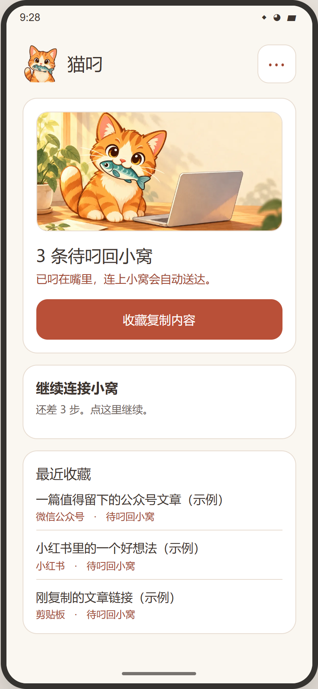
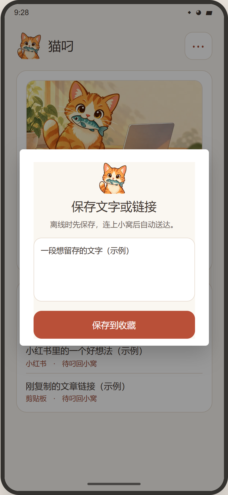
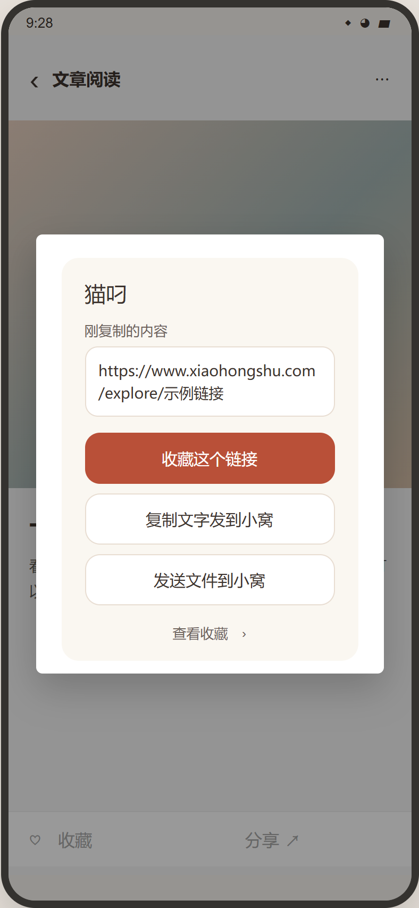

# 猫叼 / Cat Diao

安卓手机与 Windows 电脑之间的局域网小工具：收藏链接、传文字和文件，也能让电脑上的 AI 工具（如 Codex）操作已配对的手机。无需 USB 线或无线调试。

A local network companion for Android and Windows. Save links, move text and files, and let AI tools such as Codex control a paired phone. No USB cable or wireless debugging is required.

[中文](#中文) · [English](#english)

<table>
  <tr>
    <td align="center"> 首页 / Home</td>
    <td align="center"> 收藏内容 / Save</td>
    <td align="center"> 悬浮快捷面板 / Quick actions</td>
  </tr>
</table>

界面预览根据应用界面绘制，并非手机实拍。点击图片可放大。 / These are UI previews, not photos of a running phone. Click to enlarge.

## 中文

### 下载安装

以 Codex 为例，在 Windows 电脑中说：

> 请从 `https://github.com/ewanyuan/cat-diao` 安装 `cat-diao` 技能，阅读它的 `SKILL.md`，帮我完成首次配置，并告诉我如何在手机安装猫叼。

Codex 会把仓库中的 [`cat-diao/`](cat-diao/) 放到当前用户的技能目录，并运行一次 `scripts/setup.ps1`。电脑需要 Python 3；首次配置会联网安装 `openpyxl`，并设置接收程序随 Windows 登录启动。个人数据默认在 `%LOCALAPPDATA%/猫叼小窝/`，也可以在安装时自己选「猫叼小窝」的位置；配对和收藏不会放进技能目录。

2.0 是新的应用包名，安装包需要主人在本机用新钥匙签名后才能装，仓库里不附带 2.0 APK，也不附带钥匙。新签名不能覆盖旧猫叼，发布前要主人同意做一次卸载或先强制停止旧应用。旧应用里还没送出的收藏不会跟着过去，电脑上的台账还在。两边不要同时运行。

手机与电脑连到可互访的同一 Wi-Fi 后，让电脑上的 AI 发起配对。手机和电脑会各显示同一个 6 位数字，一致后再点「允许」。收藏不需要额外权限；看画面、点画面需要屏幕控制。安卓 13 及以上请先在应用信息里允许受限设置。猫叼用来做看画面、点画面的真机验证，不替代 ADB。内容在局域网上是明文，请只用信任的 Wi-Fi。

**换了 Wi-Fi 后：**只要电脑端「猫叼接收」和手机猫叼仍在运行，电脑会在后台每 10 秒查找已配对手机；两台设备恢复到可互访的同一 Wi-Fi 后，会自动更新连接地址并补送收藏。打开手机首页或点「重新检查」会发起一次真实连接检查，最多 10 秒就显示成功或未连接；后台继续重试时会保留本次结果，不会一直显示「正在重连」。若一直离线，再让电脑上的 AI 工具（如 Codex）说“重新连接猫叼”；必要时从手机首页右上角“⋯ → 小窝连接”复制连接地址。2.0 的手机和电脑要一起更新。断线后会自动重试，间隔从大约 10 秒增加到最多 60 秒。

### 可以做什么

- 在小红书、公众号等应用中分享链接到猫叼；离线时先保存在手机，电脑重新连接后补送。
- 把手机上选定的文件送到电脑，或把复制的文字送到电脑剪贴板。
- 在电脑上的 AI 工具（如 Codex）中查看手机状态、打开应用、发送文件或文字、设置壁纸；手机允许屏幕控制后还能查看和点按屏幕。
- 电脑端可选接入 WeKnora。它不是手机收件的前提，需要自行配置服务地址和专用 API key。

收到的链接写入 `%LOCALAPPDATA%/猫叼小窝/收藏台账/` 下按月份分开的 Excel 台账和本地数据库；文件放在 `%LOCALAPPDATA%/猫叼小窝/手机传来的文件/`。手机显示“已到小窝”表示电脑确认收件，不表示网页全文已抓取或 AI 已处理。

### 应用场景

1. **让 AI 做手机 App 的画面调试。** Codex 等工具在电脑上改代码、构建 APK，再通过猫叼把安装包送到手机。完成安卓的安装确认后，AI 可以打开应用、截屏、点按和滑动，根据实际画面继续修改。这个循环不需要数据线，也不依赖容易断开的无线调试。当前猫叼负责传包和画面交互；系统安装确认仍需用户操作，也不提供 logcat 或断点调试。
2. **把随手收藏变成可分析的资料。** 在小红书、公众号或网页里将链接、文字分享给猫叼；暂时连不上电脑时先留在手机，电脑重新连接后补送到台账。之后可让 AI 工具按主题整理、分析和记录反馈；配置 WeKnora 后还可继续入库。猫叼接收的是你主动分享或复制给它的内容，不会读取其他应用的整个收藏夹；AI 分析也需要另行发起。
3. **跨设备接力。** 将电脑上的提示词、草稿或文件送到手机；在手机上选好文件送回电脑，或把复制的文字放进电脑剪贴板，不用在聊天窗口里反复转发。
4. **让 AI 帮忙看手机问题。** 在手机解锁并允许屏幕控制后，电脑上的 AI 工具可以查看状态和屏幕、打开应用、调整音量或亮度、设置壁纸，并根据截图引导下一步。

### 使用边界

手机和电脑通过局域网 HTTP 通信。配对令牌不会放到网络上，每次请求单独签名；正文仍是明文，请在信任的 Wi-Fi 上使用，避免传输敏感文件。手机锁屏或长时间熄屏时可能暂停连接；解锁后再试。猫叼不在前台时，打开其他应用可能需要点手机通知。受系统保护的页面可能无法截图。当前手机界面为中文，发布包尚未在全新电脑和其他安卓机型上验证。

安卓源码在 [`android/`](android/)；可用 Android Studio 导入。构建配置采用 Android Gradle Plugin 8.7.3、Android SDK 36 和 Java 17。仓库不含签名密钥，自行构建的 APK 通常不能直接覆盖这里提供的安装包。

## English

### Install

For example, ask Codex on a Windows PC:

> Install the `cat-diao` skill from `https://github.com/ewanyuan/cat-diao`. Read its `SKILL.md`, complete the first-time setup, and show me how to install the Android app.

Codex should place [`cat-diao/`](cat-diao/) in the current user's skills directory and run `scripts/setup.ps1` once. The PC needs Python 3. Initial setup downloads `openpyxl` and starts the receiver when you sign in to Windows. Pairing details and received content stay outside the skill folder. The nest folder can stay at `%LOCALAPPDATA%/猫叼小窝/` or be chosen during setup.

Version 2.0 uses a new application id. The owner signs that build with a new key that is never stored in this repository, so the repository does not ship a 2.0 APK. The new signature cannot replace the old debug-signed app. Do not publish a release until the owner agrees to uninstall or force-stop the old app once. Pending saves on the phone do not move; the computer ledger stays. Do not run both apps at once.

Connect the phone and PC to the same trusted Wi-Fi. Pairing shows the same 6-digit code on the phone and on the PC; approve only when they match. Saving needs no extra permission. Seeing and tapping the screen is real-device checking and does not replace ADB. Traffic on the LAN is plaintext.

**After changing Wi-Fi:** while the PC receiver and phone service are running, the PC searches for the paired phone every 10 seconds. When both devices return to a Wi-Fi network where they can reach each other, the address is refreshed and pending saves are sent automatically. Opening the phone home page or tapping “重新检查” starts a real receiver check that finishes within 10 seconds. Background retries keep the completed result visible instead of showing an endless reconnect message. Version 2.0 retries from about 10 seconds up to 60 seconds, and the phone app and PC skill must both be 2.0. If it remains offline, ask your AI tool to “reconnect Cat Diao”; if needed, copy the current address from “⋯ → 小窝连接” in the phone app and give it to the AI tool.

### What it does

- Share article links from apps such as Xiaohongshu or WeChat to Cat Diao. Links wait on the phone while offline and transfer after the PC reconnects.
- Send a selected phone file to the PC, or send copied phone text to the PC clipboard.
- Ask an AI tool on the PC for phone status, to open an app, send text or files, or set a wallpaper. With screen-control permission, it can also view and tap the screen.
- Optionally sync received links to WeKnora on the PC. Local receiving works without WeKnora; you must configure your own server URL and dedicated API key to enable it.

Received links are recorded in monthly Excel files and a local database under `%LOCALAPPDATA%/猫叼小窝/收藏台账/`. Received files are under `%LOCALAPPDATA%/猫叼小窝/手机传来的文件/`. “已到小窝” means the PC acknowledged receipt; it does not mean the full article was extracted or reviewed by AI.

### Use cases

1. **Visual testing for AI-built Android apps.** Codex or another AI tool can change code and build an APK on the PC, then send the package to the phone through Cat Diao. After you approve installation in Android, the AI can open the app, capture screenshots, tap and swipe, and use the visible results for another iteration. This loop needs neither a cable nor a wireless debugging connection. Cat Diao transfers the APK and supports screen interaction; it cannot silently approve installation or provide logcat and breakpoint debugging.
2. **Turn saved links into working knowledge.** Share or copy links and text from Xiaohongshu, WeChat articles, or web pages into Cat Diao. Items wait on the phone while the PC is unreachable and reach its ledger after the PC reconnects. You can then ask an AI tool to group, analyze, and record feedback; WeKnora indexing is optional. Cat Diao receives items you explicitly share or copy to it. It does not read every other app's saved-items list, and AI analysis must be requested separately.
3. **Move work between devices.** Send prompts, drafts, or files from the PC to the phone. Select a phone file to send back, or place copied phone text on the PC clipboard, without forwarding everything through a chat app.
4. **Get help with a phone issue.** With the phone unlocked and screen control enabled, an AI tool on the PC can inspect status and screenshots, open apps, adjust volume or brightness, set a wallpaper, and suggest the next step from what it sees.

### Limits and source

Phone and PC communicate over local HTTP using a pairing token. Use a trusted Wi-Fi network and avoid sending sensitive files. A locked or sleeping phone may pause the connection. Opening another app while Cat Diao is in the background may require tapping a phone notification; some protected screens cannot be captured. The Android UI is currently in Chinese. Fresh-PC setup and other Android models have not yet been verified.

Android source is in [`android/`](android/). Import it with Android Studio; the project specifies Android Gradle Plugin 8.7.3, Android SDK 36, and Java 17. Signing keys are not included, so your own build normally cannot update the bundled APK in place.

## 1.13 修复 / Fixes in 1.13

连接检查仍在 10 秒内给出结果。本版还修复了慢请求堵住手机接收服务、配对弹窗被后来请求替换、长中文收藏整批补送失败，以及文件传到一半误报完成的问题。电脑台账刷新会保留手写反馈与备注；可选的知识库处理耗时较长时，仍可继续接收手机收藏。

Connection checks still finish within 10 seconds. This release also fixes stalled clients blocking phone requests, pairing approval switching to an unseen request, large Chinese saves failing as a batch, and interrupted downloads being reported as complete. Ledger updates preserve user feedback and remarks. Slow optional knowledge processing can run while new saves arrive.

回归检查可运行 `tests/run.ps1`；使用临时数据和本地测试服务，不写入个人收藏或知识库。测试需要 Python（含 `openpyxl`）和 Java 17 或以上。

Run `tests/run.ps1` for regression checks. It uses temporary data and local test servers without writing to personal ledgers or knowledge bases. Python with `openpyxl` and Java 17 or later are required.

## License / 许可

[MIT License](LICENSE). Runtime data, credentials, received files, and signing keys are not included in this repository. / 仓库不含运行数据、凭据、接收的文件或签名密钥。

## 1.14 蓝牙备用连接 / Bluetooth fallback

换网络后，可以用蓝牙自动找回地址；Wi-Fi 不通时也能补送收藏中的链接和文字。手机与电脑两端需一起更新，保留原有猫叼配对，再在系统设置里完成一次蓝牙配对。首页提示已简化，文件、屏幕和直接发送剪贴板仍通过 Wi-Fi。已在当前手机与电脑验证蓝牙连接；Wi-Fi 关闭后的收藏补送仍需单独验收。[使用与验证说明](docs/bluetooth-1.14.md)。

Version 1.14 adds Bluetooth address recovery and saved link/text delivery when Wi-Fi is unavailable. Update both components, keep the existing app pairing, and pair the devices once in system Bluetooth settings. Files, screen control and direct clipboard transfers still use Wi-Fi. Bluetooth connection has been verified on the current phone and PC. Save delivery with Wi-Fi turned off still requires a separate hardware check.
